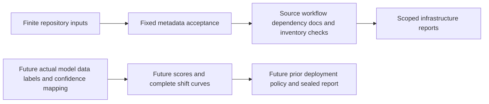

<!--
SPDX-License-Identifier: AGPL-3.0-or-later
Commercial license available
© Concepts 1996–2026 Miroslav Šotek. All rights reserved.
© Code 2020–2026 Miroslav Šotek. All rights reserved.
ORCID: 0009-0009-3560-0851
Contact: www.anulum.li | protoscience@anulum.li
SPIKE-CALIBRATOR — repository governance and provenance
-->

# Architecture

The implemented surface is local repository validation tooling under tools/calibrator_validation. Fixed scripts validate repository metadata, source provenance, workflow policy, exact development dependencies, documentation and inventory, and run explicit validation profiles. Structured reports describe the named infrastructure operation. Input cannot choose executable code or a weaker policy.

Metadata acceptance precedes inventory generation. An independently pinned closed schema binds the repository identity, governance profile, interpreter and raw development lock. Generation exclusively creates a new complete output. Verification neither repairs input nor supplies scientific qualification.

The planned model-confidence library measures declared spiking confidence signals, finite scores and reliability curves across a prior shift-by-placement population. Actual labels, raw output, explicit confidence mapping, numerical definitions, prior thresholds and current quality precede evaluation. Calibration of classifiers is distinct from calibration of physical instruments.

Future report sealing belongs to EVIDENCE-MANIFEST-TOOLKIT, data and quality to their actual owners, and physical evidence to accepted adapter/instrument providers. Deployment Pack, Ledger and Studio will consume the same attributed report. None is an installed runtime dependency or qualified consumer here.

Read the [component guide](docs/ARCHITECTURE.md), [trust boundaries](docs/THREAT_MODEL.md) and [validation commands](VALIDATION.md).
